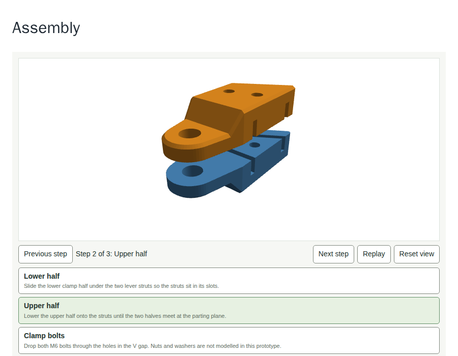
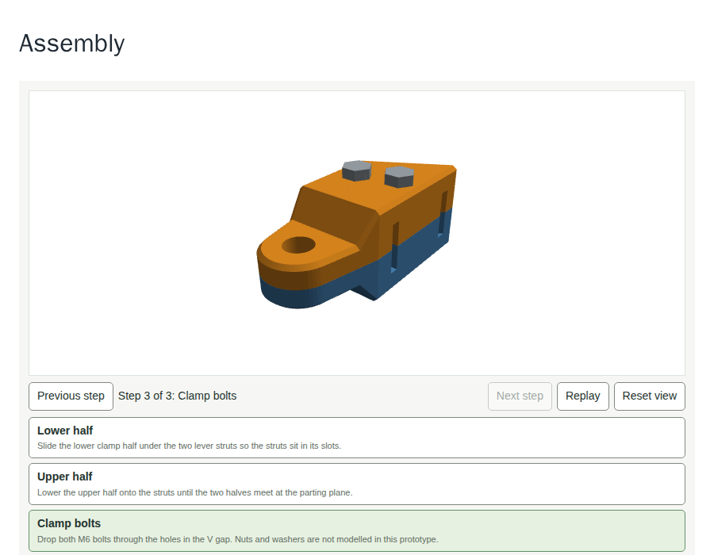

# Assembly view (prototype)

One step-by-step 3D view of two clamp halves and two bolts, for the spike [#130](https://github.com/OpenReloading/BuildGuide/issues/130) of [#47](https://github.com/OpenReloading/BuildGuide/issues/47). It lives on a branch only and is not meant to be merged. Run it with `npm run serve -w packages/core` and open http://127.0.0.1:8080/example/assembly/.

## What is in it

| File | Role |
|---|---|
| `src/buildguide-assembly.js` | classic script, WebGL 1, no third-party code: binary STL parser, flat-lit shader, orbit camera, step list, one tween per item |
| `src/buildguide.js` | the call site: `data-buildguide="assembly"` loads the script with `loadScript` when a block mounts, nothing otherwise |
| `src/buildguide.css` | eight rules for the canvas, the bar and the step list |
| `tests/size.test.mjs` | the new file has its own budget; the file pattern knows `-assembly` |
| `tests/assembly.spec.mjs` | mounts the example, counts the requests, steps, turns the view by key, checks reduced motion |
| `example/assembly/` | page, `guide.json` (the `assembly` object) and three binary STL files |
| `prototype/assembly/` | this file, two screenshots, `stl-binary.mjs`, `bolt.scad` |

The two clamp halves come from the MIT-licensed handle clamp in `cad/` of OpenReloading/AutoLever (commit `d31a866`), cut out of its assembled view (`half_top()` and `half_bottom()` with the default parameters) and written as binary STL with `stl-binary.mjs`. The bolt is an invented M6x40 hex bolt (`bolt.scad`). The struts, nuts and washers are not modelled.

## What it shows

Step 1 seats the lower half, step 2 lowers the upper half, step 3 drops both bolts (one model, two instance matrices). Each item travels from its `explode` vector to its placement in 900 ms with an ease-out, items of one step start 0.3 of a step apart. With `prefers-reduced-motion: reduce` the final position is drawn at once. The canvas takes focus: arrow keys turn, `+` and `-` zoom, `Home` resets; pointer drag and wheel do the same. Without WebGL the canvas is replaced by a sentence and the step list stays. The text of each step is in the DOM, the canvas label carries the current step.

## Byte cost (gzip level 6, as in `tests/size.test.mjs`)

| Part | Raw | Gzipped |
|---|---|---|
| `buildguide-assembly.js` (loaded only with an assembly block) | 10.4 kB | 4187 |
| `buildguide.js` call site | | +155 (12002 to 12157, budget 12700) |
| `buildguide.css` rules | | +140 (5770 to 5910, budget 6300) |
| clamp-top.stl, clamp-bottom.stl, bolt.stl (1376, 1390 and 148 triangles) | 68884, 69584, 7484 | 15471, 15687, 1320 |

The STL files are unindexed (50 bytes per triangle). Whether a host compresses `.stl` files on the wire is not measured.

## Checked

Headless Chromium in the dev container (software WebGL, no flags): the five tests in `tests/assembly.spec.mjs` pass (a page without an assembly block requests neither the renderer nor a model), with no request outside the test server, no console error and no failed response; the whole core browser suite passes (177 passed, 6 skipped); `npm run lint` and `npm test` pass.

## Not checked

Touch gestures, `forced-colors`, a dark page background (the canvas is transparent, the model colours are fixed), Firefox and WebKit, a lost WebGL context, `file:` pages, the MkDocs and Docusaurus wrappers, the data schema (`schema/buildguide.schema.json` rejects the `assembly` key, `buildguide-check` does not look at it), ticking steps in the shared storage.
